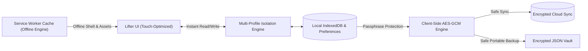

# 🏋️ FORGE — Private, Offline-First Gym & PR Tracker

<p align="center">
  <a href="https://github.com/Neeraj3102/neerajgymtracker/stargazers"></a>
  <a href="https://github.com/Neeraj3102/neerajgymtracker/network/members"></a>
  
  
  
  
</p>

<p align="center">
  <b>Build strength. Keep proof. A distraction-free workout journal engineered for serious lifters.</b><br/>
  <i>Zero subscriptions. Zero ads. Zero telemetry. 100% free and open-source.</i>
</p>

<p align="center">
  <a href="https://neerajtracker.netlify.app/"><strong>🚀 Launch Live App »</strong></a>
  ·
  <a href="https://github.com/Neeraj3102/neerajgymtracker/stargazers"><strong>⭐️ Star on GitHub</strong></a>
  ·
  <a href="#-key-features">Key Features</a>
  ·
  <a href="#-architecture">Architecture</a>
  ·
  <a href="#-running-locally">Quickstart</a>
</p>

---

## 🎯 The Philosophy

Most modern fitness apps have evolved into social media networks cluttered with influencer feeds, premium paywalls, locked history, and background telemetry. 

**FORGE is built differently:**
- **Zero Friction In The Gym**: Log sets, reps, and RPE in under 2 seconds between sets.
- **Offline Reliability**: Works in underground basements and airplane mode without a cell signal.
- **Data Sovereignty**: Your training data is saved directly on your device. When synced, it is encrypted via AES-GCM *before* it leaves your browser.
- **Multi-User Profile Switching**: Seamlessly manage isolated profiles for gym partners or training blocks on the same device.

---

## 🔥 Key Features

- **⚡ Customizable 7-Day PPL & Bro Splits**: Built-in Push, Pull, Legs, Upper, Lower routines with customizable exercise ordering and rest timers.
- **📈 Automatic PR & Overload Tracking**: Automatically flags personal bests (1RM estimation, volume records, and rep PRs) dynamically as you log.
- **🛡️ Client-Side AES-GCM Encryption**: Encrypts your entire training history using a private passphrase known only to you.
- **👥 Multi-User Profiles**: One-click profile switcher with isolated workout logs, personal bests, and routine sets.
- **📦 Clean JSON Backup & Restore**: One-click full export and import with conflict protection so you never lose a workout.
- **📱 True Progressive Web App (PWA)**: Install directly to iOS Home Screen or Android without an app store middleman.
- **⚖️ Dual Unit Normalization**: Smoothly toggle between Kilograms (kg) and Pounds (lb) with underlying normalized storage.

---

## 🏗️ Architecture



---

## 🚀 Running Locally

```bash
# 1. Clone the repository
git clone https://github.com/Neeraj3102/neerajgymtracker.git
cd neerajgymtracker

# 2. Serve with any static web server (no compilation required)
python -m http.server 4173

# 3. Open in your browser
# http://localhost:4173
```

---

## 🌟 Support & Community

If you find **FORGE** helpful for your training, please consider giving it a ⭐️ **Star** on GitHub — it helps more lifters discover private, offline-first fitness tools!

Feel free to open an [Issue](https://github.com/Neeraj3102/neerajgymtracker/issues) for feature suggestions or routine templates.

---

## 📄 License

Distributed under the **MIT License**. Crafted for lifters by [Neeraj](https://github.com/Neeraj3102).
